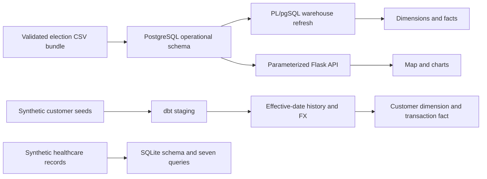

# Advanced Databases Portfolio

[](https://github.com/jorge-barb-pereira/advanced-databases-portfolio/actions/workflows/checks.yml)

Three runnable studies in database engineering and analytics: **PostgreSQL/PostGIS election analytics**, a **SQLite healthcare database**, and **dbt customer-transaction modeling**. This maintained edition brings supplied academic source code into a reproducible portfolio with English documentation, synthetic examples and automated checks.

| Project | Demonstrated skills | Start here |
| --- | --- | --- |
| Election analytics | Relational modeling, atomic ETL, PL/pgSQL, audit triggers, PostGIS, star schema, analytical SQL, Flask | [Election guide](docs/ELECTIONS.md) |
| Healthcare database | SQLite constraints, temporal overlap checks, joins, aggregation, ranking | [Healthcare guide](healthcare/README.md) |
| Customer analytics | dbt staging/intermediate/mart layers, effective-date history, currency conversion, running balances, data tests | [dbt guide](dbt/customer_analytics/README.md) |

The election coursework identifies the **2025/2026 academic year**. The election dataset's 2021 label describes the election, not the development date. Exact original dates for the healthcare and generic dbt work are unconfirmed. **Maintained edition: October 2026.** See [provenance and credits](docs/PROVENANCE.md).

## Install

Requires Python 3.11+; PostgreSQL/PostGIS is needed only for the election platform. From the repository directory:

```bash
python -m venv .venv
# Windows PowerShell: .venv\Scripts\Activate.ps1
# Linux/macOS: source .venv/bin/activate
python -m pip install -e .
python -m unittest discover -s tests -v
python tools/audit_sources.py
```

PostgreSQL tests are explicitly skipped unless `RUN_DB_TESTS=1` targets a fresh, dedicated test database. The GitHub workflow runs them against a real PostGIS service.

## Run the election dashboard

```bash
# Copy .env.example to .env and set your own local DB_PASS.
docker compose up -d --wait
python -m election_portfolio.etl init
python -m election_portfolio.etl validate
python -m election_portfolio.etl load
python -m election_portfolio.web
```

Open [the local dashboard](http://127.0.0.1:5000). It provides a territory map, vote and participation charts, elected-body selection and JSON APIs. The bundled input contains **invented territories, square geometries and votes**, visibly labeled in the UI. Leaflet assets and OpenStreetMap tiles require internet access; tabular results and the built-in charts do not depend on the map library.

Initialization refuses to overwrite existing `eleicoes` or `dw` schemas. Loading validates an entire normalized CSV bundle, imports it in one transaction and refreshes warehouse facts. Repeating the example load does not duplicate results. Invalid imports roll back rather than reporting success. The maintained loader never deletes territories to force an expected count.

## Run the healthcare project

```bash
python healthcare/demo.py
```

This executes all seven maintained queries against an in-memory SQLite database containing invented patients and contacts. It requires neither Docker nor a database account. Overlapping patient/room stays are rejected on both insertion and update; adjacent stays are allowed.

## Run the dbt project

```bash
python -m pip install -r requirements-dbt.txt
python tools/run_dbt.py
python tools/check_dbt_results.py
```

The wrapper generates a local DuckDB profile under ignored `output/`, builds three synthetic seeds and seven models, and runs dbt data tests. Independent result checks verify currency conversion, an exact effective-date boundary, latest customer state and separate account balances. No external warehouse account or supplied private dataset is needed.

## Architecture



## Review and scope

The maintained edition corrects the D'Hondt quotient tie rule, stale warehouse facts, ambiguous vote winners, database connection cleanup, malformed-number handling, admission-overlap logic and a broken healthcare query. The [review](docs/REVIEW.md) explains these decisions and remaining limitations. The [validation record](docs/VALIDATION.md) distinguishes local checks from actual database integration.

Selected originals are preserved in `historical/` with hashes; their known defects remain documented. Earlier SQL exercises and separately attributed public dbt-course models are study references rather than additional production services. Profiles, original seed records, raw datasets, virtual environments, generated dbt artifacts, private context and identifying origin metadata are excluded. See [source coverage](docs/PROVENANCE.md) and [attribution](THIRD_PARTY_NOTICES.md).

This repository demonstrates database techniques. The synthetic examples do not establish official election results, complete national geographic coverage, clinical suitability or accounting compliance.
