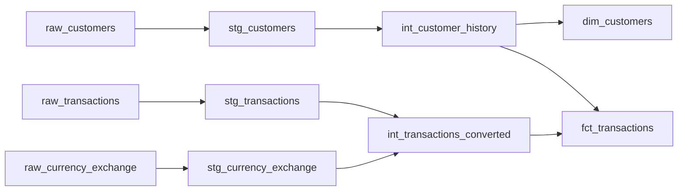

# Customer Transaction Analytics with dbt

A generic analytics-engineering study with staging views, effective-date customer history and dimensional marts. The public demonstration replaces all supplied input records with invented data. It contains no original connection profile, private account identifiers or identifying project context.

From the repository root:

```bash
python -m pip install -r requirements-dbt.txt
python tools/run_dbt.py
python tools/check_dbt_results.py
```

The runner generates a DuckDB-only profile from `profiles.example.yml` in ignored `output/dbt/profiles/`, disables anonymous dbt usage reporting and writes all databases, logs and compiled artifacts under `output/dbt/`. It never reads an original warehouse profile or connects to an external account. The [DuckDB adapter](https://github.com/duckdb/dbt-duckdb) makes this a local standalone demonstration.

## Models



Customer updates define half-open date ranges `[valid_from_date, valid_to_date)`, ending at the next update or the sentinel 9999-12-31. Transactions on an update date use the new customer state. Duplicate same-day updates are rejected by tests because their ordering is ambiguous. This is a reconstruction from dated source versions, not an incremental dbt snapshot implementation.

Exchange rates are defined as **EUR per unit of native currency**, so amount_eur = amount x rate. Missing rates fail rather than silently dropping a contribution. Rates must be positive and unique per date/currency; EUR must have rate one. Daily facts have one row per date/customer/account and use the country effective at transaction time. Deposits and withdrawals are nonnegative; the running balance is cumulative net movement with an assumed zero opening balance. It is not a reconciled statement balance. There is no source transaction ID, so the demo does not infer that equal-looking source transactions are duplicates.

## Tests and independent examples

dbt checks nulls, relationships, accepted states/types, effective intervals, FX key uniqueness and positivity, EUR rates, temporal coverage, nonnegative movements and fact grain. No external dbt-utils package is required. The maintained YAML fixes a misplaced generic test in the supplied schema.

The independent Python result check expects 100 USD at 0.90 EUR/USD minus a 20 EUR withdrawal to yield 70 EUR. A 50 EUR deposit at the next customer-state boundary yields 120 EUR on the same account. A second account's 25 USD deposit at 0.92 yields 23 EUR without inheriting the first account's balance. All customer IDs, channels and rows in these examples are invented.

Run `python tools/run_dbt.py` again to reproduce the build. The models are fully rebuilt; incremental loading, intraday updates, opening balances and accounting certification are outside the study.
